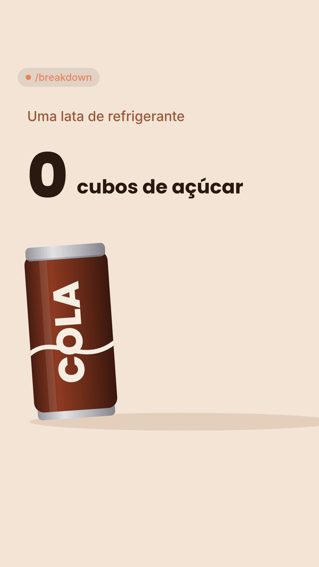
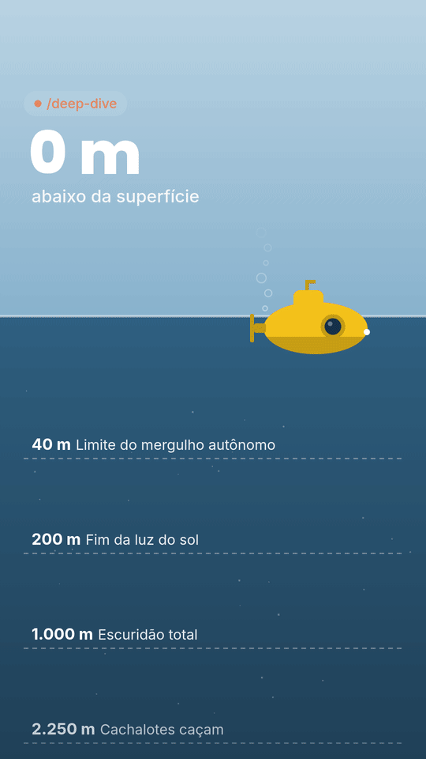
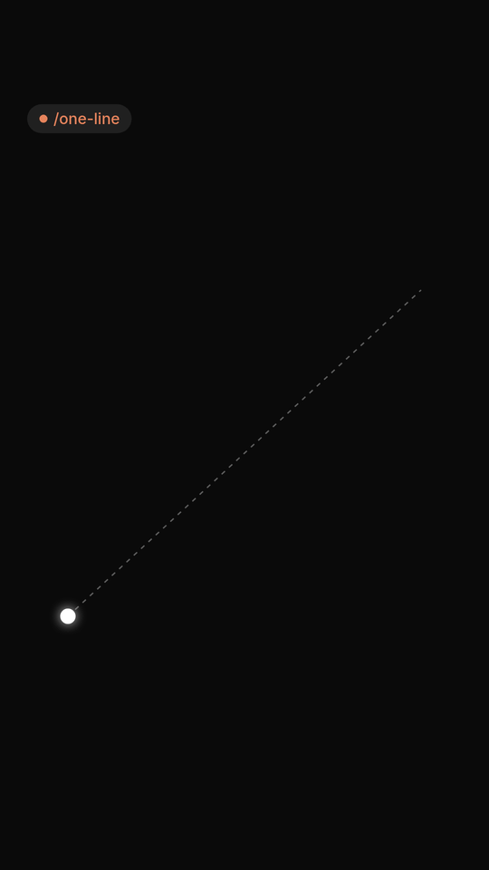
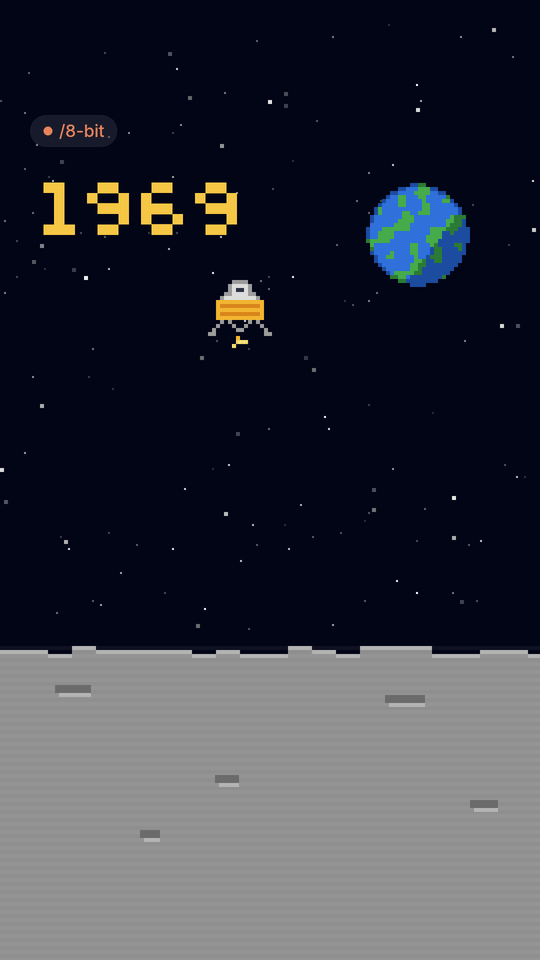
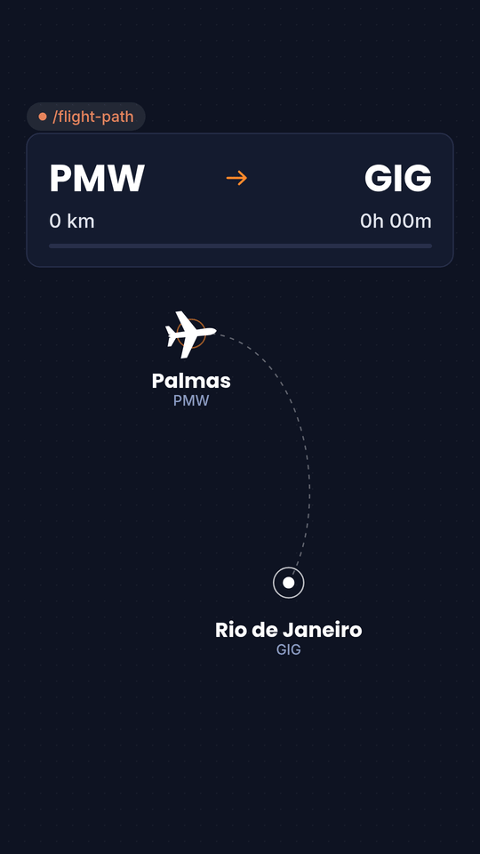
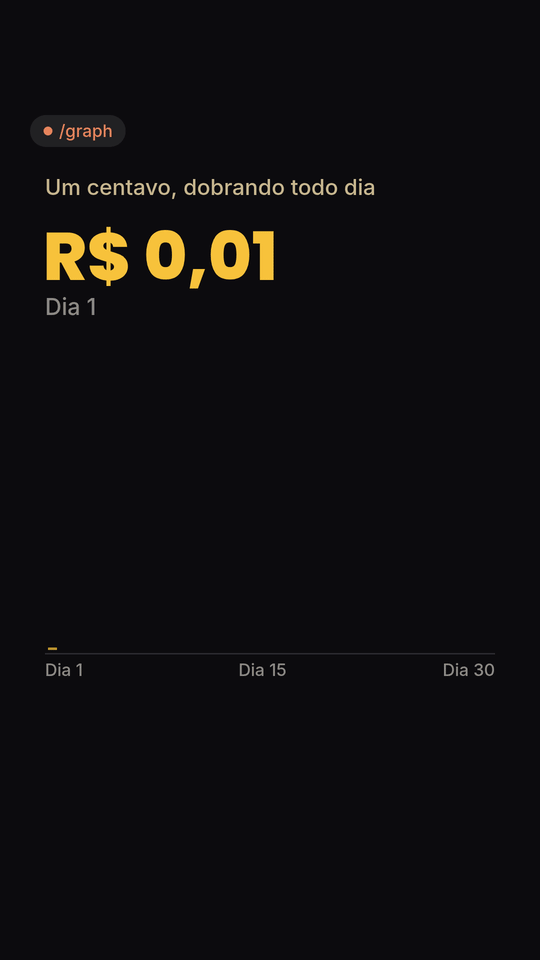

# 6 skills de animação para Reels

Digite um pedido curto como `/flight-path de Palmas para o Rio de Janeiro` e receba uma animação vertical pronta (1080×1920, 30 fps, MP4).
Sem filmagem, sem After Effects, sem Blender. Gratuito, código aberto (MIT) e roda no seu computador.

Funciona no **Claude Code**, no **Codex CLI** e em qualquer IA que rode comandos no terminal (Gemini CLI, Cursor, Copilot, Windsurf, Aider…). Também dá para usar sem IA, pela linha de comando.

| /breakdown | /deep-dive | /one-line | /8-bit | /flight-path | /graph |
|---|---|---|---|---|---|
|  |  |  |  |  |  |

## O que você precisa

- Uma IA que rode comandos no terminal (Claude Code, Codex CLI, Gemini CLI, Cursor…)
- Node 18 ou mais novo
- ffmpeg

Nenhuma chave de API.

## Instalação

```bash
# macOS
brew install ffmpeg node
# Ubuntu / Debian / WSL
sudo apt install ffmpeg   # e Node 18+ (https://nodejs.org ou nvm)

git clone https://github.com/luizcarvalho/skills.git ~/skills
cd ~/skills/animacoes && ./install.sh
```

O `install.sh` instala o Playwright, baixa o Chromium usado na renderização (uma vez, ~150 MB) e liga as seis skills em `~/.claude/skills/`.

- **Codex CLI:** `./install.sh --codex` também liga em `~/.codex/skills/`.
- **Outra pasta de skills:** `./install.sh --to /caminho/da/pasta`.
- **Outras IAs:** `./install.sh --no-link` e abra a pasta `animacoes` na sua ferramenta. O [`AGENTS.md`](AGENTS.md) explica o fluxo para qualquer assistente.
- **Já tem Chrome/Chromium?** `CHROME_PATH=/caminho/do/chrome ./install.sh` pula o download.

## As 6 skills

### 1. `/breakdown`: do que algo é feito de verdade
Transforma uma quantidade abstrata em objetos que dá para contar. Os itens caem um a um e empilham ao lado de uma embalagem (lata, pote, caixa) enquanto o contador sobe. No fim, uma pílula com o número real.
**Prompt:** `/breakdown Quanto açúcar tem numa lata de refrigerante?`
**Tempo de render:** cerca de 20 s.

### 2. `/deep-dive`: descida com marcos
Um submarino (ou mergulhador) desce enquanto o contador de profundidade sobe. Cada marco cruza o veículo exatamente no valor certo, a luz some, o farol acende e o fundo aparece (com ou sem naufrágio).
**Prompt:** `/deep-dive Qual a profundidade do Titanic, de verdade?`
**Tempo de render:** cerca de 25 s.

### 3. `/one-line`: uma ideia, uma linha
Preto e branco, uma frase e uma linha viva que sobe, cai e volta, mas termina acima de onde começou. Funciona branco no preto ou preto no branco. Ótimo para hábitos, paciência e consistência.
**Prompt:** `/one-line O progresso não é uma linha reta`
**Tempo de render:** cerca de 15 s.

### 4. `/8-bit`: cenas retrô em pixel art
Céu estrelado, planeta, chão e sprites que seguem trajetos no tempo: módulo lunar, astronauta, foguete, OVNI e bandeiras (Brasil, EUA, Portugal). A IA também pode desenhar sprites novos. A legenda final é digitada letra a letra.
**Prompt:** `/8-bit O pouso na Lua de 1969 em 8-bit`
**Tempo de render:** cerca de 20 s.

### 5. `/flight-path`: rota animada entre duas cidades
O mapa é orientado pela direção real entre as cidades. O avião percorre o arco, o cartão mostra os códigos dos aeroportos e a distância e o tempo contam até "Pousou". A distância sai das coordenadas, e o tempo é estimado se você não informar.
**Prompt:** `/flight-path De Palmas para o Rio de Janeiro`
**Tempo de render:** cerca de 20 s.

### 6. `/graph`: gráfico que cresce
Um número grande conta até o valor final enquanto as barras se formam. Você passa os números reais (seguidores, reais, quilos, porcentagem) ou uma regra, como "dobrar todo dia". Tema escuro ou claro, uma cor de destaque.
**Prompt:** `/graph Um centavo, dobrando todo dia por 30 dias`
**Tempo de render:** cerca de 15 s.

*Tempos medidos num computador com Linux (WSL2). Vídeos de 5,5 a 6 s.*

## Como funciona

1. **Você pede em linguagem natural**, com prompts como os de cima.
2. **A IA escreve um spec**: um JSON curto com seus números, lugares, textos e cores. Cada skill tem um `SKILL.md` com todos os campos e regras.
3. **Renderiza no seu computador.** Cada quadro é desenhado em Canvas 2D num Chrome sem janela (Playwright) e codificado com ffmpeg. Tudo é função do tempo, então o mesmo spec sempre gera o mesmo vídeo.
4. **Confere a zona segura.** A IA gera uma folha de contato com faixas vermelhas onde ficam os botões e a legenda do Reels e corrige o que estiver embaixo delas.

Nada é enviado para a internet. As skills mandam a IA **nunca inventar dados**: números vêm de você ou de uma fonte citada, e estimativas são ditas como estimativas.

## Usando sem IA

```bash
cd ~/skills/animacoes
node engine/render.mjs graph                                  # exemplo padrão
node engine/render.mjs graph skills/graph/example.json --gif  # com spec + GIF
node engine/render.mjs flight-path meu-voo.json --sheet       # só a folha de contato
node engine/render.mjs 8-bit --still 2.5                      # um quadro em PNG
```

Os arquivos saem em `./animacoes-out/`. Para pré-visualizar, abra `skills/<nome>/template.html` no navegador (espaço pausa, setas avançam um quadro, R reinicia). Um spec na URL também funciona: `template.html#{"title":"Meu título"}`.

## Crie sua própria skill

Cada skill é uma pasta com quatro arquivos:

- `skills/<nome>/SKILL.md`: quando usar, passo a passo, campos do spec e regras (é o que a IA lê)
- `skills/<nome>/template.html`: a animação em Canvas 2D, registrada com `E.register({ defaults, setup, draw })`
- `skills/<nome>/example.json`: um spec de exemplo
- `skills/<nome>/render.sh`: atalho para renderizar (igual em todas)

Para criar uma nova, copie `skills/graph`, mude o template e rode `./install.sh` de novo. Ou peça à sua IA: *"crie uma nova skill neste repositório que anime X, no mesmo formato da /graph"*.

## Licença

Código sob [MIT](../LICENSE). As fontes (Inter, Poppins, Silkscreen) estão sob a SIL Open Font License; veja [`engine/fonts/OFL.txt`](engine/fonts/OFL.txt).
